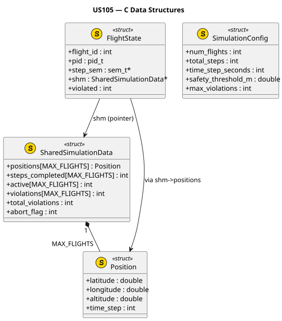
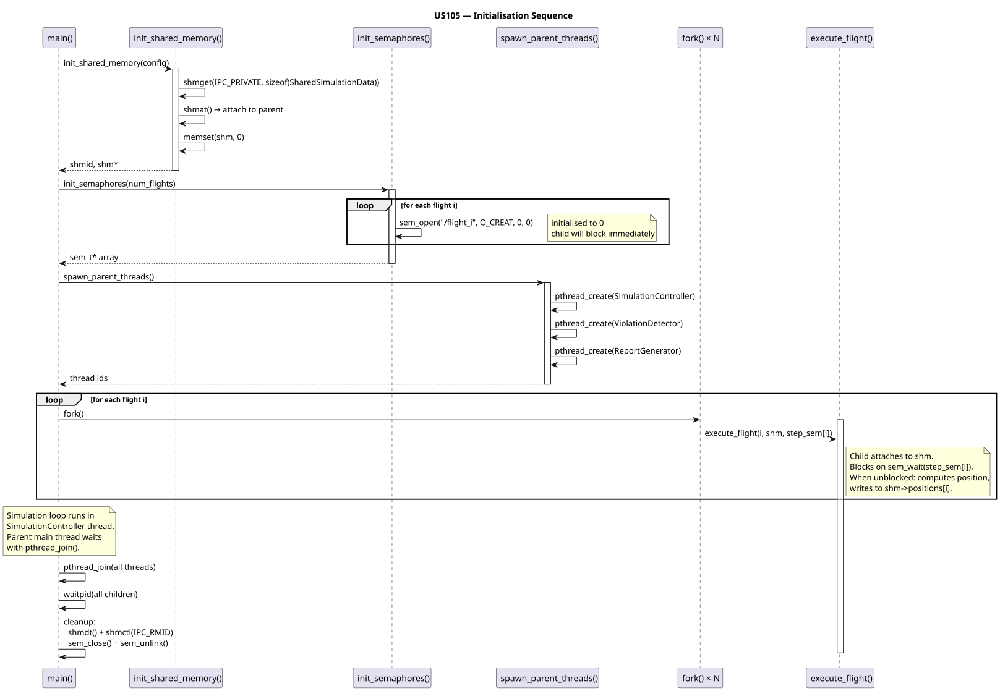

# US105 — Initialize Hybrid Simulation Environment with Shared Memory

## 1. Context

This User Story is being developed for the first time in Sprint 3. It is part of the **SCOMP** course unit and is mandatory for all students enrolled in it.

US105 extends the simulation architecture established in US100 (Sprint 2). In Sprint 2, inter-process communication was handled exclusively through **pipes** — one pipe per flight process. US105 introduces a **hybrid architecture** that replaces pipes with **shared memory** as the primary IPC mechanism, while adding **threads** to the parent process and **semaphores** for synchronisation.

This US is the foundation for US106 (function-specific threads), US107 (condition variables for violation notification), US108 (step-by-step synchronisation with shared memory), and US109 (report generation).

### 1.1 List of Issues

Analysis: Understand the difference between pipe-based IPC (Sprint 2) and shared memory IPC (Sprint 3); identify the synchronisation requirements when multiple processes access shared memory concurrently.

Design: Design the shared memory layout; design the thread architecture for the parent process; define semaphore usage for flight process synchronisation.

Implement: Replace pipe communication with shared memory; spawn threads in the parent process; initialise semaphores for each flight process.

Test: Test that shared memory is allocated and accessible by all processes; test that semaphores correctly synchronise access; test that threads in the parent run concurrently.

---

## 2. Requirements

**US105** As a Flight Control Operator, I want to start the simulation with a multi-threaded parent process and multiple child flight processes communicating through a shared memory area, so that the system efficiently coordinates simulation data across processes.

**Acceptance Criteria:**

- US105.1 — The parent process must spawn dedicated threads for its functionalities.
- US105.2 — Each flight is launched as an independent process (via `fork()`).
- US105.3 — A shared memory segment must be allocated and properly initialised for inter-process communication.
- US105.4 — Flight processes must use semaphores for synchronisation.
- US105.5 — This component must be implemented in **C** and must utilise **threads**, **mutexes**, **condition variables**, and **signals**.

**Dependencies/References:**

- Depends on **US100** — the basic simulation architecture (processes, position tracking, safety violations) is defined there. US105 replaces the pipe IPC with shared memory.
- Extends **US101**, **US102**, **US103** — all position capture, violation detection and step synchronisation must be adapted to use shared memory instead of pipes.
- Extended by **US106** — defines the specific threads spawned by the parent.
- Extended by **US107** — condition variables for violation notification.
- Extended by **US108** — step-by-step synchronisation using the new architecture.
- Extended by **US109** — report generation thread.

---

## 3. Analysis

### 3.1 Why Shared Memory Instead of Pipes

In Sprint 2, each flight process had a dedicated pipe to the parent:

```
Sprint 2 (pipes):
  Parent ← read(pipe_0) ← Child 0
  Parent ← read(pipe_1) ← Child 1
  Parent ← read(pipe_2) ← Child 2
```

With shared memory, all processes access a single memory region directly:

```
Sprint 3 (shared memory):
  Parent ─────────────────────────────┐
  Child 0 ─── shmget/shmat ────────→ SharedMemory[positions[]]
  Child 1 ─── shmget/shmat ────────→ SharedMemory[positions[]]
  Child 2 ─── shmget/shmat ────────→ SharedMemory[positions[]]
```

This eliminates the overhead of pipe `write()`/`read()` calls and allows the parent to read any flight's position directly without blocking.

### 3.2 Shared Memory Layout

The shared memory segment contains the simulation state shared between the parent and all child processes:

```c
typedef struct {
    Position positions[MAX_FLIGHTS];      /* current position of each flight */
    int      steps_completed[MAX_FLIGHTS];/* step counter per flight */
    int      active[MAX_FLIGHTS];         /* 1=running, 0=finished */
    int      violations[MAX_FLIGHTS];     /* violation count per flight */
    int      total_violations;            /* global violation counter */
    int      abort_flag;                  /* 1=simulation must stop */
} SharedSimulationData;
```

### 3.3 Synchronisation Architecture

Since multiple processes write to shared memory concurrently, access must be controlled:

| Mechanism | Purpose |
|---|---|
| **Semaphore per flight** | Controls when each child writes its position (step sync) |
| **Mutex** | Protects concurrent writes to `total_violations` and `abort_flag` |
| **Condition variable** | Parent thread waits until all flights complete a step |
| **SIGUSR1** | Notifies flight processes of safety violations (kept from Sprint 2) |
| **SIGTERM** | Terminates flight processes on abort (kept from Sprint 2) |

### 3.4 Thread Architecture (Parent Process)

The parent process no longer does everything in a single loop. It spawns dedicated threads:

```
Parent Process
    ├── Thread: SimulationController   (main loop, step coordination)
    ├── Thread: ViolationDetector      (checks safety distances at each step)
    ├── Thread: ReportGenerator        (accumulates data, writes report)
    └── Main thread                    (spawns threads, waits, handles signals)
```

Details of each thread are defined in US106–US109.

---

## 4. Design

### 4.1 Design Decisions

- **`shmget` + `shmat`** — POSIX System V shared memory API, available on Linux without extra libraries.
- **Named semaphores (`sem_open`)** — used for cross-process synchronisation. Each flight has one semaphore that the parent posts and the child waits on (replaces the step-token pipe from Sprint 2).
- **`pthread_mutex_t`** — protects shared counters (`total_violations`, `abort_flag`) from concurrent write access by multiple threads in the parent.
- **`pthread_cond_t`** — the simulation controller thread waits on a condition variable until all active flights have completed the current step.
- **Signal handlers preserved** — `SIGUSR1` and `SIGTERM` are kept from Sprint 2 for violation notification and abort. `volatile sig_atomic_t` flags are still used.
- **`fork()` preserved** — each flight is still a separate process. US105 only changes the IPC mechanism (pipes → shared memory) and adds threads to the parent.

### 4.2 Class Diagram (C structures)



### 4.3 Sequence Diagram — Initialisation



### 4.4 Acceptance Tests

**Test 1:** Verifies that shared memory is allocated and accessible by parent and child.

**Refers to Acceptance Criteria:** US105.3

```c
void test_shared_memory_accessible_by_child() {
    int shmid = shmget(IPC_PRIVATE,
                       sizeof(SharedSimulationData), IPC_CREAT | 0666);
    assert(shmid != -1);

    SharedSimulationData *shm = shmat(shmid, NULL, 0);
    assert(shm != (void*)-1);
    shm->total_violations = 0;
    shm->abort_flag = 0;

    pid_t pid = fork();
    if (pid == 0) {
        /* child attaches and writes */
        SharedSimulationData *child_shm = shmat(shmid, NULL, 0);
        child_shm->total_violations = 42;
        shmdt(child_shm);
        exit(0);
    }
    waitpid(pid, NULL, 0);

    /* parent sees child's write */
    assert(shm->total_violations == 42);
    shmdt(shm);
    shmctl(shmid, IPC_RMID, NULL);
    printf("PASS: test_shared_memory_accessible_by_child\n");
}
```

**Test 2:** Verifies that a semaphore blocks the child until the parent posts.

**Refers to Acceptance Criteria:** US105.4

```c
void test_semaphore_synchronises_child() {
    sem_t *sem = sem_open("/test_sem_105", O_CREAT, 0644, 0);
    assert(sem != SEM_FAILED);

    pid_t pid = fork();
    if (pid == 0) {
        sem_wait(sem); /* blocks until parent posts */
        exit(0);
    }
    sleep(0); /* give child time to block */
    sem_post(sem); /* unblock child */
    waitpid(pid, NULL, 0);

    sem_close(sem);
    sem_unlink("/test_sem_105");
    printf("PASS: test_semaphore_synchronises_child\n");
}
```

**Test 3:** Verifies that the parent spawns the required threads.

**Refers to Acceptance Criteria:** US105.1, US105.5

```c
static int thread_ran = 0;

void *dummy_thread(void *arg) {
    thread_ran = 1;
    return NULL;
}

void test_parent_spawns_threads() {
    pthread_t tid;
    pthread_create(&tid, NULL, dummy_thread, NULL);
    pthread_join(tid, NULL);
    assert(thread_ran == 1);
    printf("PASS: test_parent_spawns_threads\n");
}
```

**Test 4:** Verifies that mutex protects shared counter from concurrent access.

**Refers to Acceptance Criteria:** US105.5

```c
static pthread_mutex_t test_mutex = PTHREAD_MUTEX_INITIALIZER;
static int shared_counter = 0;

void *increment_counter(void *arg) {
    for (int i = 0; i < 1000; i++) {
        pthread_mutex_lock(&test_mutex);
        shared_counter++;
        pthread_mutex_unlock(&test_mutex);
    }
    return NULL;
}

void test_mutex_protects_shared_counter() {
    pthread_t t1, t2;
    shared_counter = 0;
    pthread_create(&t1, NULL, increment_counter, NULL);
    pthread_create(&t2, NULL, increment_counter, NULL);
    pthread_join(t1, NULL);
    pthread_join(t2, NULL);
    assert(shared_counter == 2000);
    printf("PASS: test_mutex_protects_shared_counter\n");
}
```

---

## 5. Implementation

**`simulation.h` — Updated structures**
- `SharedSimulationData` struct allocated in shared memory via `shmget/shmat`.
- `FlightState` updated: replaces `pipe_read`/`pipe_step` file descriptors with `sem_t *step_sem` (semaphore pointer).
- `SimulationConfig` unchanged from Sprint 2.

**`simulation.c` — `init_shared_memory()`**
- Calls `shmget(IPC_PRIVATE, sizeof(SharedSimulationData), IPC_CREAT | 0666)`.
- Calls `shmat()` to attach the segment to the parent's address space.
- Initialises all fields to zero and `active[i] = 1` for each flight.
- Stores the `shmid` for cleanup at the end.

**`simulation.c` — `init_semaphores()`**
- Creates one named semaphore per flight: `sem_open("/flight_0", ...)`, `sem_open("/flight_1", ...)`, etc.
- Initialised to 0 — child blocks immediately on `sem_wait()`.

**`simulation.c` — `spawn_parent_threads()`**
- Calls `pthread_create()` for each parent thread (simulation controller, violation detector, report generator).
- Stores thread IDs for later `pthread_join()`.

**`flight.c` — `execute_flight()` updated**
- Removes `read(pipe_step)` — replaced with `sem_wait(step_sem)` (blocks until parent posts).
- Removes `write(pipe_write, &pos, sizeof(Position))` — replaced with direct write to `shm->positions[flight_id]`.
- Signal handlers (`SIGUSR1`, `SIGTERM`) and `volatile sig_atomic_t` flags kept unchanged.

**`simulation.c` — `cleanup()`**
- Calls `shmdt()` and `shmctl(IPC_RMID)` to detach and remove shared memory.
- Calls `sem_close()` and `sem_unlink()` for all semaphores.
- Calls `pthread_join()` for all parent threads.
- Calls `waitpid()` for all child processes (kept from Sprint 2).

---

## 6. Integration/Demonstration

**Demonstration of US105:**
1. Run the simulation with the same command-line interface as Sprint 2:
   ```bash
   ./simulation 3 10 1 50000 5
   ```
2. The output is identical to Sprint 2 — the change is internal (pipes replaced by shared memory).
3. Use `ipcs -m` before and after the simulation to demonstrate that the shared memory segment is created and then removed.
4. Add `printf("[FLIGHT %d] Wrote position to shm\n", flight_id)` in `execute_flight()` to show that children write directly to shared memory.
5. The parent threads can be demonstrated by adding `printf("[THREAD] ViolationDetector started\n")` etc. at thread startup.

---

## 7. Observations

- **Shared memory vs pipes**: Pipes are unidirectional and require a syscall for each message. Shared memory is a single memory region accessed directly by all processes — faster for high-frequency position updates, but requires explicit synchronisation (semaphores, mutexes).
- **Why semaphores replace the step-token pipe**: In Sprint 2, the parent sent a 1-byte token via pipe to unblock the child. In Sprint 3, `sem_post()` replaces this — same effect, no pipe needed.
- **`volatile sig_atomic_t` flags preserved**: Signal handlers from Sprint 2 (`SIGUSR1`, `SIGTERM`) are unchanged. The flags `sigusr1_received` and `sigterm_received` remain `volatile sig_atomic_t` for the same reasons.
- **Resource cleanup is critical**: shared memory segments persist in the OS after the process ends (unlike pipes). Always call `shmctl(IPC_RMID)` and `sem_unlink()` in cleanup — otherwise `ipcs -m` will show stale segments.
- **Thread safety**: only the parent threads access `total_violations` and `abort_flag` for writing. Children write only to their own `positions[flight_id]` slot — no mutex needed for position writes (each child has exclusive ownership of its slot).
