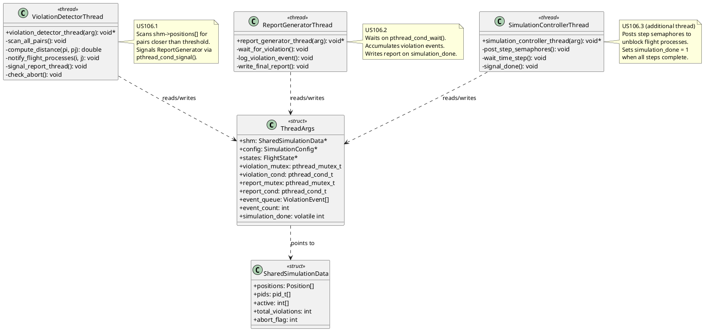
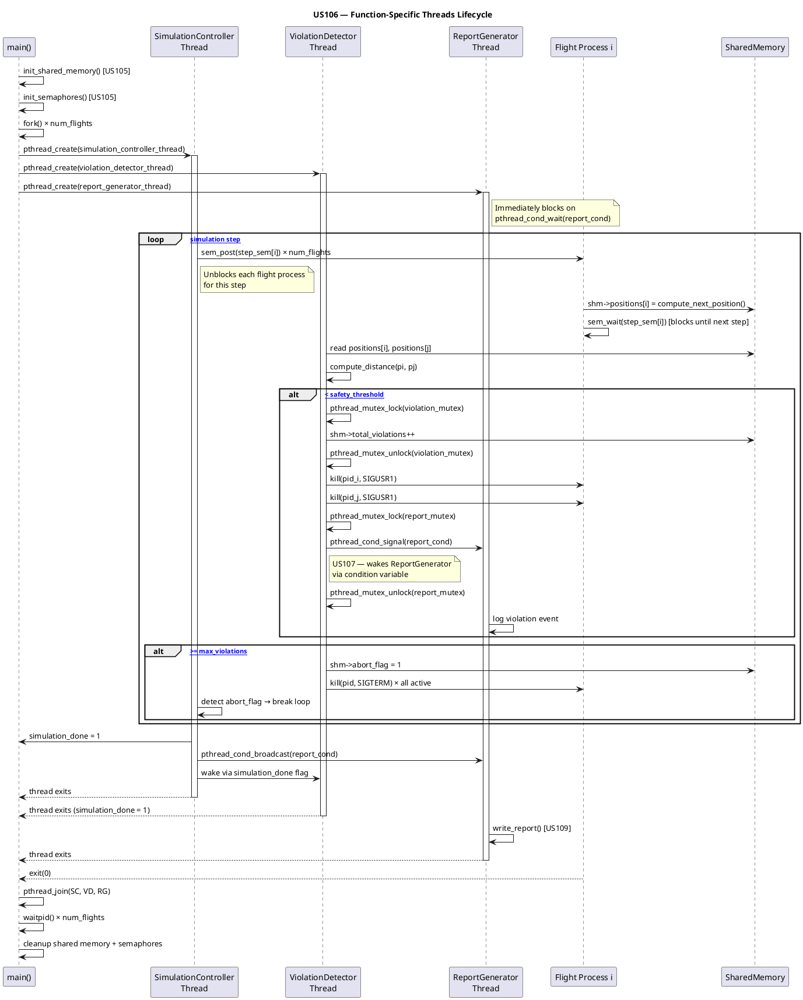

# US106 — Implement Function-Specific Threads in the Parent Process

## 1. Context

This User Story is being developed for the first time in Sprint 3. It is part of the
**SCOMP** course unit and is mandatory for all students enrolled in it.

US106 builds directly on **US105** — which initialised the hybrid simulation environment
with shared memory and spawned the parent threads. US105 sets up the infrastructure;
US106 defines exactly **what each thread does** and how they are managed with mutexes
and condition variables.

In Sprint 2, the parent process had a single sequential loop that read positions from
pipes, checked for violations, and generated the report — all in sequence. US106
decomposes these responsibilities into dedicated concurrent threads so each function
operates independently and in parallel.

This US is a prerequisite for **US107** (condition variables for violation notification)
and **US109** (report generation thread).

### 1.1 List of Issues

Analysis: Identify which functionalities need dedicated threads; understand the data
they share and the synchronisation required between them.

Design: Design the thread functions; define mutex and condition variable usage; define
the thread lifecycle (creation, work loop, termination).

Implement: Implement `violation_detector_thread()` and `report_generator_thread()`;
integrate with shared memory from US105.

Test: Test that both threads run concurrently; test that the violation detector scans
shared memory; test that mutex protects shared counters from concurrent access.

---

## 2. Requirements

**US106** As a PO, I want the simulation controller parent process to have at least two
dedicated threads (one for safety violation detection and one for report generation),
so that each functionality operates concurrently and independently.

**Acceptance Criteria:**

- US106.1 — The parent process creates a safety violation detection thread responsible
  for scanning the shared memory for aircraft flight conflicts.
- US106.2 — A report generation thread is created to compile simulation results and
  respond to safety violation events.
- US106.3 — Any additional thread deemed appropriate for the required functionalities.
- US106.4 — Threads are managed using mutexes and condition variables for internal
  synchronisation.

**Dependencies/References:**

- Depends on **US105** — shared memory, semaphores and thread creation infrastructure.
- Extended by **US107** — condition variables for violation notification between threads.
- Extended by **US109** — report generation thread produces the final report file.
- Referenced in the specification, section 6.7 (SCOMP related user stories).

---

## 3. Analysis

### 3.1 Why Dedicated Threads

In Sprint 2, the parent process ran a single sequential loop:

```
Sprint 2 (sequential):
  loop:
    read_all_positions()       ← blocks waiting for pipe reads
    check_safety_violations()  ← runs after ALL reads done
    write_report()             ← runs only at the very end
```

With dedicated threads, each function runs concurrently and independently:

```
Sprint 3 (concurrent threads):
  SimulationController thread  ← coordinates steps, posts semaphores
  ViolationDetector thread     ← scans shared memory at each step
  ReportGenerator thread       ← waits on condition variable, logs violations
```

This means violation detection does not block on position reads, and the report thread
does not block the simulation loop — both run truly concurrently.

### 3.2 Thread Responsibilities

| Thread | Function | Trigger | Output |
|---|---|---|---|
| `SimulationController` | Coordinates steps, posts semaphores | Time step | `sem_post()` per flight |
| `ViolationDetector` | Scans positions in shared memory | Each step | `pthread_cond_signal()` to report thread |
| `ReportGenerator` | Accumulates violations, writes report | Condition variable signal | Report file |

### 3.3 Shared State Between Threads

All parent threads share the same `ThreadArgs` struct. Access to shared counters must
be protected by mutex:

| Shared data | Protected by |
|---|---|
| `shm->total_violations` | `pthread_mutex_t violation_mutex` |
| `shm->abort_flag` | `pthread_mutex_t violation_mutex` |
| `shm->positions[]` | Read-only by parent threads (children write to own slot only) |
| Violation event queue | `pthread_mutex_t report_mutex` + `pthread_cond_t report_cond` |

### 3.4 Thread Lifecycle

```
main()
  │
  ├── init_shared_memory()          [US105]
  ├── init_semaphores()             [US105]
  │
  ├── pthread_create → SimulationController
  │       loop: post semaphores, wait for step completion
  │
  ├── pthread_create → ViolationDetector  [US106.1]
  │       loop: scan shm->positions[], compute distances
  │             → pthread_cond_signal(report_cond) on violation
  │
  ├── pthread_create → ReportGenerator   [US106.2]
  │       loop: pthread_cond_wait(report_cond)
  │             → log violation event
  │       on simulation_done: write report to file
  │
  ├── fork() × num_flights
  │
  └── pthread_join all threads
      waitpid all child processes
      cleanup shared memory + semaphores
```

---

## 4. Design

### 4.1 Design Decisions

- **Two mandatory threads** — `ViolationDetector` (US106.1) and `ReportGenerator`
  (US106.2) as required. A third `SimulationController` thread is added (US106.3)
  to coordinate step-by-step progression — this separates step coordination from
  violation detection.
- **`pthread_mutex_t`** — protects all writes to `total_violations`, `abort_flag`
  and the violation event queue. Reads by the violation detector are also mutex-protected
  to avoid torn reads on the counter.
- **`pthread_cond_t`** — `ViolationDetector` signals `ReportGenerator` when a violation
  is detected. `ReportGenerator` waits on this condition — it never busy-waits.
- **`ThreadArgs` struct** — all thread arguments are passed via a single struct
  containing shared memory pointer, mutexes, condition variables, config and the
  `simulation_done` flag. Avoids global variables.
- **`volatile int simulation_done`** — set to `1` by the main thread after all steps
  complete. Threads check this flag in their loops to exit cleanly.

### 4.2 Data Structures

```c
/* Passed to all parent threads */
typedef struct {
    SharedSimulationData *shm;           /* shared memory (US105) */
    SimulationConfig     *config;        /* simulation parameters */
    FlightState          *states;        /* per-flight state array */

    pthread_mutex_t       violation_mutex;
    pthread_cond_t        violation_cond;

    pthread_mutex_t       report_mutex;
    pthread_cond_t        report_cond;

    ViolationEvent        event_queue[MAX_VIOLATIONS];
    int                   event_count;

    volatile int          simulation_done; /* 1 = simulation ended */
} ThreadArgs;
```

### 4.3 Thread Function Skeletons

**US106.1 — Safety violation detection thread:**

```c
void *violation_detector_thread(void *arg) {
    ThreadArgs *args = (ThreadArgs *) arg;

    while (!args->simulation_done) {

        pthread_mutex_lock(&args->violation_mutex);

        /* scan all pairs of active flights */
        for (int i = 0; i < args->config->num_flights; i++) {
            for (int j = i + 1; j < args->config->num_flights; j++) {
                if (!args->shm->active[i] || !args->shm->active[j])
                    continue;

                double dist = compute_distance(
                        &args->shm->positions[i],
                        &args->shm->positions[j]);

                if (dist < args->config->safety_threshold_m) {
                    args->shm->total_violations++;

                    /* notify flight processes */
                    kill(args->states[i].pid, SIGUSR1);
                    kill(args->states[j].pid, SIGUSR1);

                    /* notify report thread (US107) */
                    pthread_mutex_lock(&args->report_mutex);
                    pthread_cond_signal(&args->report_cond);
                    pthread_mutex_unlock(&args->report_mutex);

                    /* abort if too many violations */
                    if (args->shm->total_violations >=
                            args->config->max_violations) {
                        args->shm->abort_flag = 1;
                        for (int k = 0; k < args->config->num_flights; k++) {
                            if (args->shm->active[k])
                                kill(args->states[k].pid, SIGTERM);
                        }
                    }
                }
            }
        }

        pthread_mutex_unlock(&args->violation_mutex);
        usleep(10000); /* yield — avoid busy spin */
    }
    return NULL;
}
```

**US106.2 — Report generation thread:**

```c
void *report_generator_thread(void *arg) {
    ThreadArgs *args = (ThreadArgs *) arg;

    pthread_mutex_lock(&args->report_mutex);

    while (!args->simulation_done) {
        /* wait for violation notification (US107) */
        pthread_cond_wait(&args->report_cond, &args->report_mutex);

        /* copy and log new violation data */
        pthread_mutex_lock(&args->violation_mutex);
        /* ... log events from shm ... */
        pthread_mutex_unlock(&args->violation_mutex);
    }

    pthread_mutex_unlock(&args->report_mutex);

    /* simulation done — write final report (US109) */
    write_report(args->shm, args->config, args->states);
    return NULL;
}
```

**US106.3 — Simulation controller thread (additional):**

```c
void *simulation_controller_thread(void *arg) {
    ThreadArgs *args = (ThreadArgs *) arg;

    for (int step = 0; step < args->config->total_steps; step++) {
        if (args->shm->abort_flag) break;

        /* unblock each flight process for this step */
        for (int i = 0; i < args->config->num_flights; i++) {
            if (args->shm->active[i])
                sem_post(args->states[i].step_sem);
        }

        sleep(args->config->time_step_seconds);
    }

    args->simulation_done = 1;

    /* wake all waiting threads */
    pthread_cond_broadcast(&args->report_cond);
    pthread_cond_broadcast(&args->violation_cond);

    return NULL;
}
```

### 4.4 Class Diagram (C structures)



### 4.5 Sequence Diagram



### 4.6 Acceptance Tests

**Test 1:** Verifies that both required threads are created and run.

**Refers to Acceptance Criteria:** US106.1, US106.2

```c
static volatile int vd_ran = 0;
static volatile int rg_ran = 0;

void *mock_violation_detector(void *arg) {
    vd_ran = 1;
    return NULL;
}

void *mock_report_generator(void *arg) {
    rg_ran = 1;
    return NULL;
}

void test_both_threads_run() {
    pthread_t vd, rg;
    pthread_create(&vd, NULL, mock_violation_detector, NULL);
    pthread_create(&rg, NULL, mock_report_generator, NULL);
    pthread_join(vd, NULL);
    pthread_join(rg, NULL);
    assert(vd_ran == 1);
    assert(rg_ran == 1);
    printf("PASS: test_both_threads_run\n");
}
```

**Test 2:** Verifies that mutex protects the violation counter from concurrent access.

**Refers to Acceptance Criteria:** US106.4

```c
static pthread_mutex_t test_mutex = PTHREAD_MUTEX_INITIALIZER;
static int violation_counter = 0;

void *increment_violations(void *arg) {
    for (int i = 0; i < 1000; i++) {
        pthread_mutex_lock(&test_mutex);
        violation_counter++;
        pthread_mutex_unlock(&test_mutex);
    }
    return NULL;
}

void test_mutex_protects_violation_counter() {
    pthread_t t1, t2;
    violation_counter = 0;
    pthread_create(&t1, NULL, increment_violations, NULL);
    pthread_create(&t2, NULL, increment_violations, NULL);
    pthread_join(t1, NULL);
    pthread_join(t2, NULL);
    assert(violation_counter == 2000);
    printf("PASS: test_mutex_protects_violation_counter\n");
}
```

**Test 3:** Verifies that condition variable wakes the report thread on signal.

**Refers to Acceptance Criteria:** US106.4

```c
static pthread_mutex_t cond_mutex = PTHREAD_MUTEX_INITIALIZER;
static pthread_cond_t  cond_var   = PTHREAD_COND_INITIALIZER;
static volatile int    notified   = 0;

void *waiting_thread(void *arg) {
    pthread_mutex_lock(&cond_mutex);
    while (!notified)
        pthread_cond_wait(&cond_var, &cond_mutex);
    pthread_mutex_unlock(&cond_mutex);
    return NULL;
}

void test_condition_variable_wakes_report_thread() {
    pthread_t t;
    notified = 0;
    pthread_create(&t, NULL, waiting_thread, NULL);
    usleep(10000); /* give thread time to reach cond_wait */
    pthread_mutex_lock(&cond_mutex);
    notified = 1;
    pthread_cond_signal(&cond_var);
    pthread_mutex_unlock(&cond_mutex);
    pthread_join(t, NULL);
    assert(notified == 1);
    printf("PASS: test_condition_variable_wakes_report_thread\n");
}
```

**Test 4:** Verifies that violation detector reads positions from shared memory.

**Refers to Acceptance Criteria:** US106.1

```c
void test_violation_detector_reads_shared_memory() {
    int shmid = shmget(IPC_PRIVATE,
                       sizeof(SharedSimulationData), IPC_CREAT | 0666);
    assert(shmid != -1);
    SharedSimulationData *shm = shmat(shmid, NULL, 0);

    /* two flights very close together */
    shm->positions[0].latitude  = 41.2481;
    shm->positions[0].longitude = -8.6814;
    shm->positions[1].latitude  = 41.2482;
    shm->positions[1].longitude = -8.6815;
    shm->active[0] = 1;
    shm->active[1] = 1;
    shm->total_violations = 0;

    double dist = compute_distance(&shm->positions[0], &shm->positions[1]);
    assert(dist < 1000.0); /* below typical safety threshold */

    shmdt(shm);
    shmctl(shmid, IPC_RMID, NULL);
    printf("PASS: test_violation_detector_reads_shared_memory\n");
}
```

**Test 5:** Verifies that `simulation_done` flag causes threads to exit cleanly.

**Refers to Acceptance Criteria:** US106.4

```c
static volatile int sim_done_flag = 0;

void *thread_checks_done(void *arg) {
    while (!sim_done_flag)
        usleep(1000);
    return NULL;
}

void test_simulation_done_flag_exits_thread() {
    pthread_t t;
    sim_done_flag = 0;
    pthread_create(&t, NULL, thread_checks_done, NULL);
    usleep(5000);
    sim_done_flag = 1;
    pthread_join(t, NULL);
    printf("PASS: test_simulation_done_flag_exits_thread\n");
}
```

---

## 5. Implementation

**`simulation.h` — New structures:**
- `ThreadArgs` struct — passed to all parent threads via `pthread_create()`.
- Contains pointers to shared memory, config, flight states, mutexes, condition
  variables and the `simulation_done` flag.

**`threads.c` / `threads.h`** — Thread function implementations:
- `violation_detector_thread(void *arg)` — US106.1. Scans all pairs of active flights
  each iteration. Protects counter access with `violation_mutex`. Signals report thread
  with `pthread_cond_signal(report_cond)` on violation.
- `report_generator_thread(void *arg)` — US106.2. Blocks on
  `pthread_cond_wait(report_cond, report_mutex)`. Logs violation events. Calls
  `write_report()` when `simulation_done = 1`.
- `simulation_controller_thread(void *arg)` — US106.3. Posts step semaphores, sleeps
  one time step, checks `abort_flag`. Sets `simulation_done = 1` and broadcasts on
  all condition variables when done.

**`simulation.c` — `spawn_parent_threads()`:**
- Initialises `pthread_mutex_t` and `pthread_cond_t` fields in `ThreadArgs` with
  `PTHREAD_MUTEX_INITIALIZER` and `PTHREAD_COND_INITIALIZER`.
- Calls `pthread_create()` for each of the three threads.
- Stores thread IDs for later `pthread_join()`.

**`simulation.c` — `join_parent_threads()`:**
- Sets `args.simulation_done = 1`.
- Calls `pthread_cond_broadcast()` on both condition variables to wake all waiting threads.
- Calls `pthread_join()` for each thread ID.

---

## 6. Integration/Demonstration

**Demonstration of US106:**

1. Run the simulation:
   ```bash
   ./simulation 3 10 1 10000 2
   ```

2. Thread startup messages show concurrent execution:
   ```
   [THREAD] SimulationController started (tid=139956...)
   [THREAD] ViolationDetector started   (tid=139957...)
   [THREAD] ReportGenerator started     (tid=139958...)
   ```

3. When a violation is detected, condition variable notification is visible:
   ```
   [VD] Step 3: flight 0 and flight 1 — distance=5423m < threshold=10000m
   [VD] Violation #1 — sending SIGUSR1 to PID 12345, 12346
   [VD] Signalling report thread via pthread_cond_signal
   [RG] Woken by condition variable — logging violation #1
   ```

4. At the end, the report thread writes the file:
   ```
   [RG] simulation_done=1 — writing final report
   [RG] Report saved: simulation_report_20260601_143022.txt
   ```

---

## 7. Observations

- **Why condition variables instead of busy-waiting**: the report thread must not poll
  shared memory continuously — that wastes CPU. `pthread_cond_wait()` atomically
  releases the mutex and suspends the thread until signalled, consuming zero CPU.
- **Spurious wakeups**: `pthread_cond_wait()` can return without being signalled.
  Always wrap it in a `while` loop checking the actual condition, not an `if`.
- **Thread-safe signal handling**: signals (`SIGUSR1`, `SIGTERM`) are delivered to the
  process, not a specific thread. Only the flight child processes handle these signals —
  parent threads mask them with `pthread_sigmask()` if necessary.
- **Mutex ordering**: always acquire mutexes in the same order across all threads to
  avoid deadlock. Convention: always `violation_mutex` before `report_mutex`.
- **`simulation_done` visibility**: declared as `volatile int` so the compiler does not
  cache it in a register — every read goes to memory, ensuring all threads see the
  updated value.