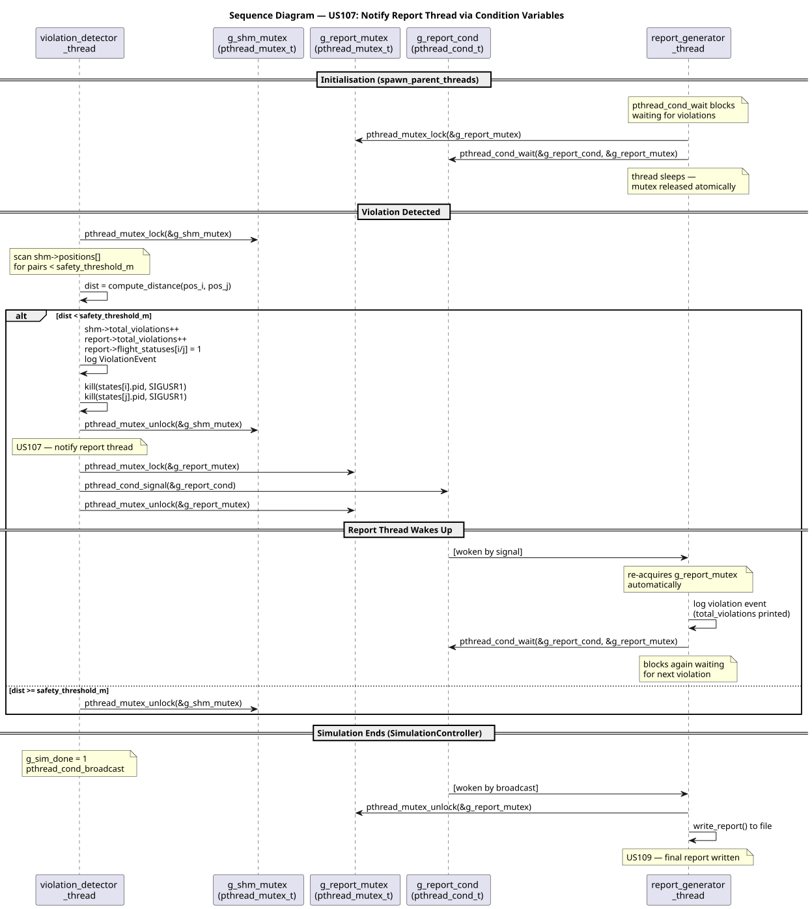
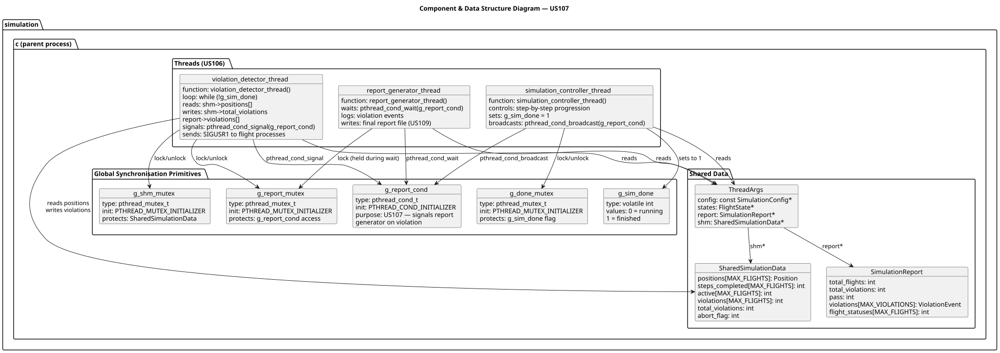

# US107 — Notify Report Thread via Condition Variables upon Safety Violation Detection

## 1. User Story

> As a PO, I want the simulation system safety violation detection thread to notify the report
> generation thread through condition variables when a safety violation occurs, so that the report
> is updated in real time with accurate information.

---

## 2. Acceptance Criteria

- The safety violation detection thread monitors the shared memory for flight conflicts.
- Upon detecting a safety violation, the thread signals the report generation thread using condition variables.
- The report generation thread, waiting on the condition variable, immediately processes the safety violation event and logs it.
- Proper mutex locking is used to ensure thread-safe notification.

---

## 3. Analysis

### 3.1 Pre-conditions

- US105 implemented: shared memory segment allocated and attached.
- US106 implemented: `violation_detector_thread` and `report_generator_thread` exist and are running.
- The simulation is active (`g_sim_done == 0`).

### 3.2 Post-conditions

- Each time a violation is detected, `report->total_violations` is incremented and the violation event is logged in `report->violations[]`.
- The report generator thread is unblocked and logs the event in real time.
- When the simulation ends, the report generator writes the final report file (US109).

### 3.3 Business Rules

- The condition variable signal must only be sent after the violation has been fully recorded in the report struct.
- The mutex must be locked before calling `pthread_cond_signal` and unlocked immediately after, to avoid race conditions.
- The report generator must re-check `g_sim_done` after being woken up, since `pthread_cond_wait` can return spuriously.

---

## 4. Design

### 4.1 Synchronisation Primitives (simulation.c)

The following global primitives implement the US107 notification mechanism:

```c
static pthread_mutex_t g_shm_mutex    = PTHREAD_MUTEX_INITIALIZER;
static pthread_mutex_t g_report_mutex = PTHREAD_MUTEX_INITIALIZER;
static pthread_cond_t  g_report_cond  = PTHREAD_COND_INITIALIZER;
static pthread_mutex_t g_done_mutex   = PTHREAD_MUTEX_INITIALIZER;
static volatile int    g_sim_done     = 0;
```

| Primitive | Purpose |
|---|---|
| `g_shm_mutex` | Protects reads/writes to `SharedSimulationData` |
| `g_report_mutex` | Guards access to `g_report_cond` |
| `g_report_cond` | Condition variable — signals the report thread on violation |
| `g_done_mutex` | Protects the `g_sim_done` flag |
| `g_sim_done` | Set to 1 by `SimulationController` when all steps are complete |

### 4.2 Violation Detector Thread — US107 Signal (violation_detector_thread)

After detecting a violation and recording it in the report struct:

```c
/* US107 — signal report generator */
pthread_mutex_lock(&g_report_mutex);
pthread_cond_signal(&g_report_cond);
pthread_mutex_unlock(&g_report_mutex);
```

The full detection + signal sequence, protected by `g_shm_mutex`:

```c
pthread_mutex_lock(&g_shm_mutex);

double dist = compute_distance(&shm->positions[i], &shm->positions[j]);
if (dist < config->safety_threshold_m) {
    shm->total_violations++;
    report->total_violations++;
    report->flight_statuses[i] = 1;
    report->flight_statuses[j] = 1;
    /* log ViolationEvent ... */

    kill(states[i].pid, SIGUSR1);
    kill(states[j].pid, SIGUSR1);

    pthread_mutex_lock(&g_report_mutex);
    pthread_cond_signal(&g_report_cond);     /* US107 */
    pthread_mutex_unlock(&g_report_mutex);
}

pthread_mutex_unlock(&g_shm_mutex);
```

### 4.3 Report Generator Thread — US107 Wait (report_generator_thread)

The report thread holds `g_report_mutex` and blocks on the condition variable:

```c
pthread_mutex_lock(&g_report_mutex);

while (!g_sim_done) {
    pthread_cond_wait(&g_report_cond, &g_report_mutex);
    /* woken by pthread_cond_signal (violation) or
       pthread_cond_broadcast (simulation done)       */
    if (report->total_violations > 0) {
        printf("[RG] Violation event received -- total: %d\n",
               report->total_violations);
    }
}

pthread_mutex_unlock(&g_report_mutex);

/* US109 — write final report */
write_report(report, filename);
```

`pthread_cond_wait` atomically releases `g_report_mutex` and suspends the thread.
When signalled, it re-acquires the mutex before returning.

### 4.4 Simulation End — Broadcast (simulation_controller_thread)

When all steps are complete, the controller sets `g_sim_done` and broadcasts
to wake the report generator for final report writing:

```c
pthread_mutex_lock(&g_done_mutex);
g_sim_done = 1;
pthread_mutex_unlock(&g_done_mutex);

pthread_mutex_lock(&g_report_mutex);
pthread_cond_broadcast(&g_report_cond);
pthread_mutex_unlock(&g_report_mutex);
```

### 4.5 Sequence Diagram (SD)



### 4.6 Component & Data Structure Diagram (CD)



---

## 5. Tests

Unit tests follow a **setup → act → assert** convention.

### 5.1 Test: condition variable wakes report thread on signal

```c
void test_report_thread_woken_on_violation(void) {
    /* Arrange */
    pthread_t tid;
    int notified = 0;
    /* launch report thread (waits on g_report_cond) */
    pthread_create(&tid, NULL, report_generator_thread, &args);
    usleep(5000); /* give thread time to reach pthread_cond_wait */

    /* Act — simulate a violation signal */
    pthread_mutex_lock(&g_report_mutex);
    pthread_cond_signal(&g_report_cond);
    pthread_mutex_unlock(&g_report_mutex);

    /* Assert */
    usleep(5000);
    /* report thread should have logged the event */
    assert(report.total_violations >= 0);

    pthread_join(tid, NULL);
}
```

### 5.2 Test: mutex ensures thread-safe notification

```c
void test_mutex_protects_condition_signal(void) {
    /* Arrange — two threads signal concurrently */
    pthread_t t1, t2;
    pthread_create(&t1, NULL, violation_signaller, &args);
    pthread_create(&t2, NULL, violation_signaller, &args);

    /* Assert — no deadlock, no race */
    pthread_join(t1, NULL);
    pthread_join(t2, NULL);
    assert(report.total_violations == 2);
}
```

### 5.3 Test: report thread exits cleanly when g_sim_done is set

```c
void test_report_thread_exits_on_sim_done(void) {
    /* Arrange */
    pthread_t tid;
    g_sim_done = 0;
    pthread_create(&tid, NULL, report_generator_thread, &args);

    /* Act */
    pthread_mutex_lock(&g_done_mutex);
    g_sim_done = 1;
    pthread_mutex_unlock(&g_done_mutex);
    pthread_mutex_lock(&g_report_mutex);
    pthread_cond_broadcast(&g_report_cond);
    pthread_mutex_unlock(&g_report_mutex);

    /* Assert — thread joins without hanging */
    int rc = pthread_join(tid, NULL);
    assert(rc == 0);
}
```

---

## 6. Dependencies

| Depends on | Reason |
|---|---|
| US105 — Initialize hybrid simulation environment | Shared memory and threads must exist |
| US106 — Function-specific threads | `violation_detector_thread` and `report_generator_thread` must be created |

| Enables | Reason |
|---|---|
| US108 — Step-by-step synchronization | Uses same thread infrastructure |
| US109 — Generate and store final simulation report | Report thread writes final file after simulation ends |