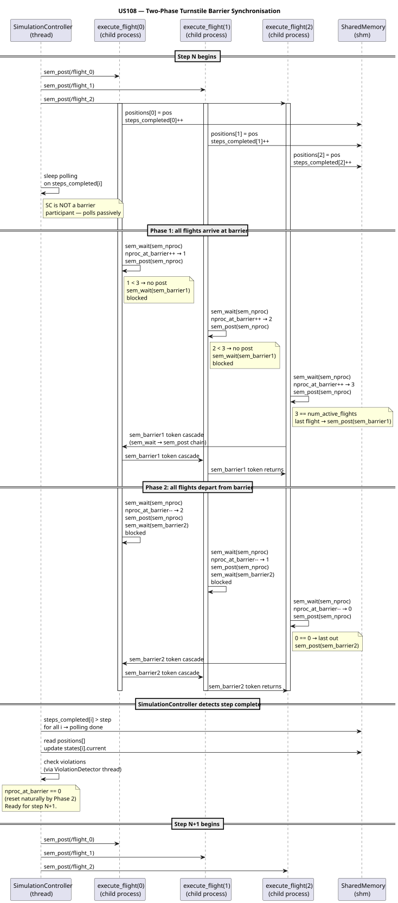

# US108 — Enforce Step-by-Step Simulation Synchronisation

## 1. Context

This User Story is being developed for the first time in Sprint 3. It is part of the **SCOMP** course unit.

US108 builds directly on the architecture introduced in US105 (shared memory + semaphores) and US106 (parent threads). In US105/US106, the SimulationController thread posts step semaphores to all flight processes and then polls `steps_completed[i]` in a busy-wait loop to detect when each flight finishes. This approach — known as **active waiting** — works but wastes CPU cycles and, critically, does not enforce a true global barrier: a faster flight could theoretically receive its next step token before slower flights have finished the current one.

US108 replaces this polling with a **semaphore-based two-phase turnstile barrier** pattern. The barrier guarantees that no flight process advances to step N+1 until every active flight has completed step N. The SimulationController no longer participates in the barrier — it drives each step by posting the per-flight semaphores and then polls `steps_completed[i]` passively via `sleep`, while the flight processes synchronise among themselves using the turnstile.

### 1.1 List of Issues

Analysis: Understand why active waiting on `steps_completed` is insufficient for strict step-by-step ordering among the flight processes themselves;

Design: Design the two-phase turnstile barrier (`sem_nproc` for mutual exclusion on the counter, `sem_barrier1` for Fase 1, `sem_barrier2` for Fase 2); design the changes to `SharedSimulationData`; define the interaction between child processes at each step boundary; define that the SimulationController is not a barrier participant.

Implement: Add `nproc_at_barrier` counter and barrier semaphore names to shared memory and init; implement two-phase turnstile barrier logic in `execute_flight()`; replace polling loop in `simulation_controller_thread()` with a `sleep`-based wait on `steps_completed`.

Test: Test that no flight advances before all flights complete the step; test that the barrier counter resets correctly between steps; test that an inactive (finished) flight is excluded from the barrier count via `num_active_flights`.

---

## 2. Requirements

**US108** As a PO, I want the simulation to advance step by step so that all flight processes complete each simulation step before any process begins the next one, ensuring consistent and reproducible simulation data.

**Acceptance Criteria:**

- US108.1 — No flight process may begin step N+1 before all active flight processes have completed step N.
- US108.2 — The SimulationController thread must not busy-wait; it posts the per-flight semaphores and waits passively on `steps_completed[i]` via `sleep`.
- US108.3 — The barrier must reset correctly at every step so that it can be reused for the full duration of the simulation.
- US108.4 — If a flight process terminates early (e.g. due to `abort_flag` or `SIGTERM`), the remaining active flights must not deadlock at the barrier.
- US108.5 — This component must be implemented in **C** using **named semaphores** and **shared memory**, consistent with the mechanisms taught in class.

**Dependencies/References:**

- Depends on **US105** — shared memory layout (`SharedSimulationData`) and named semaphores per flight.
- Depends on **US106** — the SimulationController thread, which drives the step loop and must post per-flight semaphores before waiting.
- Extended by **US109** — the ReportGenerator thread reads positions after each step completes; the barrier guarantees positions are stable before the SimulationController proceeds to the next step.

---

## 3. Analysis

### 3.1 Two-Phase Turnstile Barrier Pattern (from course slides)

The two-phase turnstile barrier uses three semaphores and a counter in shared memory. It is designed for **N equal participants** — in this case, the N flight child processes. The SimulationController thread does **not** participate in the barrier; it drives the step loop externally.

| Element | Type | Initial value | Purpose |
|---|---|---|---|
| `nproc_at_barrier` | `int` in shm | 0 | Counts how many flights have reached the barrier for the current step |
| `sem_nproc` | named semaphore | 1 | Mutual exclusion when reading/writing `nproc_at_barrier` |
| `sem_barrier1` | named semaphore | 0 | Phase 1 gate — blocks until the last flight arrives |
| `sem_barrier2` | named semaphore | 0 | Phase 2 gate — blocks until all flights have passed Phase 1 |

### 3.2 Why the SimulationController Does Not Participate in the Barrier

The two-phase turnstile is designed for N equal peers. The SimulationController is not a peer — it is the orchestrator that grants permission for each step. If it joined the barrier as the (N+1)-th participant, the barrier threshold would be `num_active_flights + 1`, but `states[i].active` is only set to 1 **after** the fork, meaning the SC could enter the barrier before any child exists and cause an immediate deadlock. Keeping the SC outside the barrier eliminates this ordering problem entirely.

### 3.3 Why Two Phases Are Needed

The single-semaphore barrier is not safely reusable across multiple steps: if a fast flight completes Phase 1 and immediately re-enters the barrier for the next step, it can increment `nproc_at_barrier` before slow flights from the previous step have finished decrementing it, corrupting the counter. Phase 2 guarantees that all N flights have **left** the barrier before any of them can re-enter it.

### 3.4 Changes to Shared Memory Layout

Two fields already present in `SharedSimulationData` are used for the barrier:

```c
typedef struct {
    Position positions[MAX_FLIGHTS];
    int      steps_completed[MAX_FLIGHTS];
    int      active[MAX_FLIGHTS];
    int      violations[MAX_FLIGHTS];
    int      total_violations;
    int      abort_flag;
    /* US108 -- barrier fields */
    int      nproc_at_barrier;          /* counter: flights currently at barrier  */
    int      num_active_flights;        /* barrier threshold; decremented on exit */
} SharedSimulationData;
```

The barrier semaphore names are defined as constants:

```c
#define SEM_NPROC_NAME    "/aisafe_nproc"
#define SEM_BARRIER1_NAME "/aisafe_barrier1"
#define SEM_BARRIER2_NAME "/aisafe_barrier2"
```

---

## 4. Design

### 4.1 Design Decisions

- **Three named semaphores** — `sem_nproc` (mutex, initialised to 1), `sem_barrier1` (Phase 1 gate, initialised to 0) and `sem_barrier2` (Phase 2 gate, initialised to 0). This is the two-phase turnstile pattern from the course theory.
- **Counter in shared memory** — `nproc_at_barrier` lives in `SharedSimulationData` so all child processes can access it. Protected by `sem_nproc`.
- **`num_active_flights` in shared memory** — the barrier threshold. When a flight terminates early, it decrements this value inside `sem_nproc` so the barrier threshold adjusts and no deadlock occurs.
- **SimulationController polls `steps_completed`** — replaces the previous approach. The SC posts the per-flight semaphores, then loops with `sleep` until every active flight increments its `steps_completed[i]`. The barrier among the flights ensures all positions are stable before the SC reads them.
- **Forks happen before threads are created** — `states[i].active` must be set to 1 before the SimulationController starts, so it does not skip posting semaphores to flights that have not yet been forked. The order in `start_simulation` is: shared memory → semaphores → **forks** → **threads**.
- **Per-flight semaphores preserved** — `sem_post("/flight_i")` from the SimulationController is kept. The barrier controls when all flights finish a step; the per-flight semaphores control when each individual flight may begin the next one.

### 4.2 Sequence Diagram — Step Barrier



### 4.3 Acceptance Tests

**Test 1:** Verifies that the barrier holds all N flights until the last one arrives (Phase 1), and that `nproc_at_barrier` returns to 0 after Phase 2 completes for all flights.

**Refers to Acceptance Criteria:** US108.1, US108.3

```c
void test_barrier_enforces_step_ordering(void) {
    const int N = 3;
    SharedSimulationData *shm = init_shared_memory(N);
    /* create SEM_NPROC_NAME (1), SEM_BARRIER1_NAME (0), SEM_BARRIER2_NAME (0) */

    for (int i = 0; i < N; i++) {
        if (fork() == 0) {
            /* Phase 1 + Phase 2 — identical to execute_flight() */
            barrier_child(shm, sem_nproc, sem_b1, sem_b2);
            exit(0);
        }
    }

    for (int i = 0; i < N; i++) waitpid(-1, NULL, 0);

    /* After Phase 2, counter must be 0 */
    assert(shm->nproc_at_barrier == 0);
    /* PASS */
}
```

**Test 2:** Verifies that the barrier counter resets to 0 after each step and works for multiple consecutive steps.

**Refers to Acceptance Criteria:** US108.3

```c
void test_barrier_resets_between_steps(void) {
    /* 1 flight, 3 steps. After each step nproc_at_barrier must be 0. */
    for (int step = 0; step < 3; step++) {
        fork() → barrier_child → exit(0);
        waitpid(-1, NULL, 0);
        assert(shm->nproc_at_barrier == 0);
    }
    /* PASS */
}
```

**Test 3:** Verifies that when one flight exits early (decrements `num_active_flights`), the remaining flight completes the barrier without deadlocking.

**Refers to Acceptance Criteria:** US108.4

```c
void test_barrier_no_deadlock_on_early_exit(void) {
    /* 2 flights. Flight 0 exits early: decrements num_active_flights.
     * Flight 1 runs the full barrier with threshold now == 1. */
    /* If no deadlock, both waitpid() calls return. PASS. */
}
```

**Test 4:** Verifies that `sem_nproc` provides mutual exclusion: N concurrent increments of `nproc_at_barrier` produce a final value of exactly N.

**Refers to Acceptance Criteria:** US108.5

```c
void test_nproc_mutex_correctness(void) {
    /* N=4 children each do: sem_wait(nproc); nproc_at_barrier++; sem_post(nproc) */
    /* After all finish, nproc_at_barrier must equal 4. */
}
```

---

## 5. Implementation

**`simulation.h` — `SharedSimulationData`**
- Fields `nproc_at_barrier` and `num_active_flights` were already present.
- Add constants `SEM_NPROC_NAME`, `SEM_BARRIER1_NAME`, `SEM_BARRIER2_NAME`.

**`simulation.c` — `init_shared_memory()`**
- Initialise `shm->nproc_at_barrier = 0` and `shm->num_active_flights = num_flights`.

**`simulation.c` — `init_semaphores()`**
- After creating per-flight semaphores, create the three barrier semaphores:
  ```c
  sem_open(SEM_NPROC_NAME,    O_CREAT | O_EXCL, 0644, 1); /* mutex */
  sem_open(SEM_BARRIER1_NAME, O_CREAT | O_EXCL, 0644, 0); /* Phase 1 */
  sem_open(SEM_BARRIER2_NAME, O_CREAT | O_EXCL, 0644, 0); /* Phase 2 */
  ```

**`simulation.c` — `start_simulation()`**
- Changed order: shared memory → semaphores → **forks** → **threads**. This ensures `states[i].active == 1` before the SimulationController starts.

**`simulation.c` — `simulation_controller_thread()`**
- Removed all barrier participation (no `sem_wait`/`sem_post` on the barrier semaphores).
- Posts per-flight semaphores for each active flight.
- Waits for all active flights via `sleep` polling on `steps_completed[i]`.
- Updates `states[i].active` and `states[i].current` from shared memory after all flights complete.

**`flight.c` — `execute_flight()`**
- Opens `SEM_NPROC_NAME`, `SEM_BARRIER1_NAME`, `SEM_BARRIER2_NAME` on start.
- After writing `shm->positions[flight_id]` and incrementing `steps_completed`, executes the full two-phase turnstile barrier.
- On early exit, decrements `shm->num_active_flights` inside `sem_nproc` before `exit(0)`.

**`simulation.c` — `cleanup_simulation()`**
- `sem_unlink` for `SEM_NPROC_NAME`, `SEM_BARRIER1_NAME`, `SEM_BARRIER2_NAME`.

---

## 6. Integration/Demonstration

**Demonstration of US108:**
1. Run the simulation with 3 flights and observe the log output:
   ```
   ./simulation 3 10 1 50000 5
   ```
2. Without US108, flights may log steps out of order (e.g. Flight 0 logs step 2 before Flight 1 logs step 1). With US108, the `[SC] Posting step N` line only appears after all flights have logged step N−1.
3. Add a deliberate `sleep(1)` inside `execute_flight()` for one flight and verify that the SimulationController does not advance to step N+1 until the slow flight completes step N.

---

## 7. Observations

- **Why three semaphores instead of one**: the single-semaphore barrier is not safely reusable across steps. A flight that completes Phase 1 quickly could re-enter the barrier for the next step and corrupt `nproc_at_barrier` before slower flights have decremented it. Phase 2 prevents this by ensuring all N processes leave the barrier before any can re-enter.
- **Why the SC is not a barrier participant**: the SC is the orchestrator, not a peer. If it joined the barrier as the (N+1)-th participant, a race between the SC thread starting and the forks completing would cause an immediate deadlock at step 0, because `states[i].active` is only set to 1 after `fork()` returns in the parent.
- **Fork-before-thread ordering**: the fix to the original deadlock was moving the fork loop before `spawn_parent_threads()`. This guarantees `states[i].active` is populated when the SC starts iterating over flights.
- **Early exit and deadlock prevention**: a terminating flight decrements `num_active_flights` inside `sem_nproc`. If the remaining flights at the barrier now equal the new threshold, the terminating process also posts `sem_barrier1`, unblocking the others. Without this, a single early exit would permanently stall the barrier.
- **Compatibility with ViolationDetector**: the ViolationDetector thread (US106) reads positions from shared memory asynchronously. With the barrier, all flight positions for step N are guaranteed to be written before the SimulationController proceeds to step N+1, eliminating the risk of reading a partially written position.
